<div align="center">

<picture>
  <source media="(prefers-color-scheme: dark)" srcset="assets/banner-dark.svg">
  <source media="(prefers-color-scheme: light)" srcset="assets/banner-light.svg">
  
</picture>

<br>

[](mailto:jennyjoelsamp@gmail.com)
[](#)
[](mailto:jennyjoelsamp@gmail.com)

</div>

## `$ cat about.md`

B.Tech CSE '25. I'm becoming a solid **Python backend developer**, then moving into **GenAI systems**: retrieval, evaluation, LLM APIs. I learn by building small, tested projects and writing down what I can and can't explain yet.

```yaml
focus:      python backend -> rag / genai
building:   kb-api next steps (BM25, embeddings)
learning:   sql, testing habits, system design basics
looking_for: entry-level python / backend / junior ai roles
```

## `$ ls projects/`

### [kb-api](https://github.com/jennyjoelsam/kb-api) &nbsp;

A FastAPI + SQLite REST service for storing and searching text documents. The foundation for a RAG support assistant.

```text
client ──► FastAPI (main.py) ──► crud.py ──► SQLAlchemy ──► SQLite
              │                      └──► search.py  (ranked: title 3x, tag 2x, body 1x)
              └──► Pydantic schemas (422 on bad input, 404 on missing)
```

| | |
|---|---|
| **API** | CRUD, tag filter, pagination, ranked keyword search, `/health` |
| **Quality** | 32 pytest tests, GitHub Actions CI on every push |
| **Ops** | Dockerfile, env-based config, request logging |
| **Honest limits** | No stemming, no auth, search scans all docs. Listed in the README |

**Roadmap:** BM25 + embedding search → RAG answers with citations → evaluation set.

## `$ cat stack.txt`

<p>
  
  
  
  
  
  
  
  
</p>

## `$ cat certifications.txt`

- IABAC Data Science Foundation
- IABAC AI Expert
- Microsoft Azure AI Fundamentals
- Google AI Essentials

## `$ ./contributions --animate`

<div align="center">
<picture>
  <source media="(prefers-color-scheme: dark)" srcset="https://raw.githubusercontent.com/jennyjoelsam/jennyjoelsam/output/snake-dark.svg">
  <source media="(prefers-color-scheme: light)" srcset="https://raw.githubusercontent.com/jennyjoelsam/jennyjoelsam/output/snake.svg">
  
</picture>
</div>

## `$ mail -s "hello" jennyjoelsamp@gmail.com`

Email is the fastest way to reach me.
